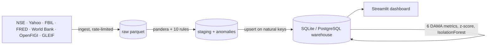
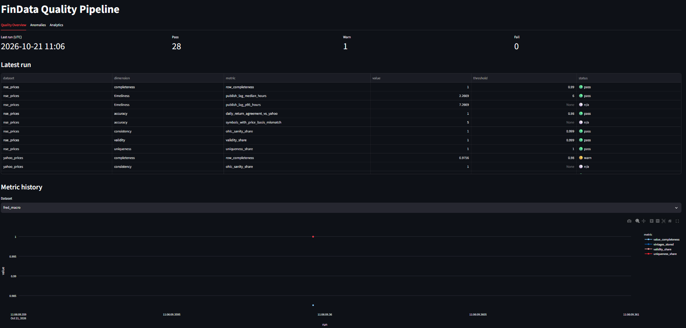
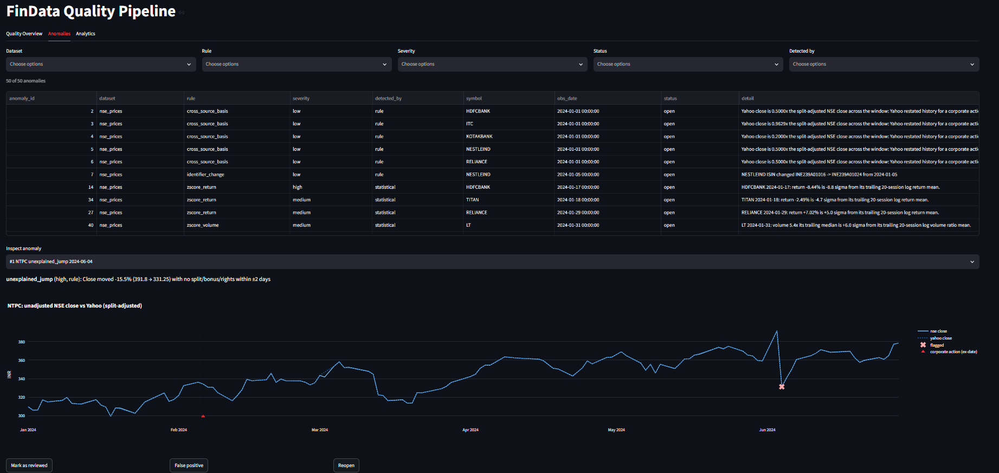
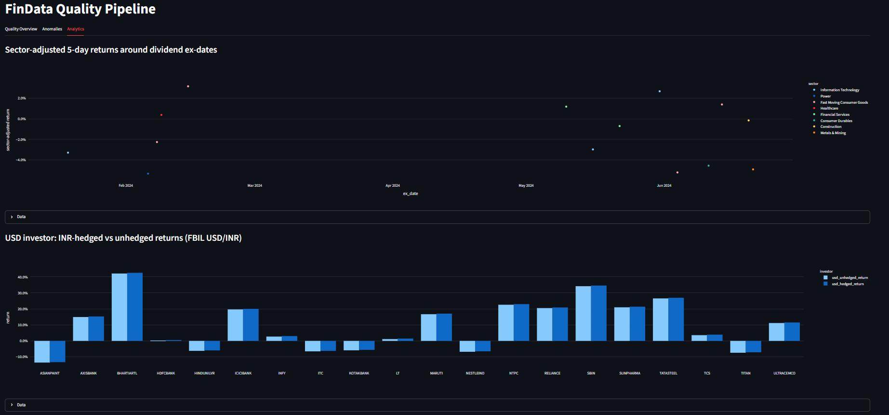

# FinData Quality Pipeline

This project acquires, validates, models and monitors Indian and global market data, and
publishes the result as a data-quality dashboard. It covers 20 NIFTY-50 stocks for
H1 2024. All of the data is real, downloaded from public sources, and a 1 MB sample is
committed so that everything runs offline.



## Run it (offline, from a fresh clone)

```bash
uv sync                                   # Python 3.12 venv in .venv
uv run findata load                       # migrate DB, validate samples, load warehouse
uv run findata quality run                # metrics + statistical/ML anomalies + report
uv run streamlit run dashboard/app.py     # or: uv run findata dashboard
```

With uv's package cache already warm, a clone-to-loaded-warehouse run took 58 s. The
dashboard builds the warehouse on first start if it is missing.

To fetch live data (network required; clients are rate-limited and cache to `data/raw`):

```bash
uv run findata ingest all --from 2024-01-01 --to 2024-06-30
uv run findata validate all --mode raw    # load re-validates only if staging is missing
uv run findata load --mode raw
uv run findata samples build              # re-cut data/samples from raw
```

Checks (all must pass before a commit):

```bash
uv run pytest -q --cov=src/findata        # 163 tests, 96% coverage, no network
uv run ruff check . && uv run ruff format --check . && uv run mypy src   # mypy --strict
```

## Screenshots

**Quality Overview:** one traffic light per dataset × dimension, plus the metric history.
(This capture is from a run made while the World Bank API was down, so its counts are
28/1/0 rather than 31/1/0.)



**Anomalies:** filterable flag list, and the NTPC 2024-06-04 drop plotted against Yahoo with
corporate actions marked. Each flag can be marked reviewed or false positive.



**Analytics:** sector-adjusted returns around dividend ex-dates, and INR-hedged vs unhedged
returns for a USD investor.



## What's inside

| Layer | Where | Highlights |
|---|---|---|
| Contracts | `config/datasets/*.yaml` | One YAML per dataset drives the pandera schema, rule parameters, quality thresholds and the data dictionary |
| Ingest | `src/findata/ingest/` | NSE bhavcopy (UDiFF), NSE corporate actions, NSE equity master, Yahoo, FBIL reference rates (the RBI reference-rate administrator since 2018), FRED, World Bank, **OpenFIGI** (the open FIGI standard Bloomberg originated), GLEIF LEI. All clients are rate-limited, retried, idempotent and partitioned by date |
| Validation | `src/findata/validate/` | OHLC sanity, missing trading days, duplicate keys, stale price, unexplained jump, split-ratio check, cross-source return diff, identifier conflict, FX z-score outlier, macro revision. Rules are pure functions returning `Anomaly` records |
| Model | `src/findata/model/`, `migrations/` | Star-ish schema, Alembic migration, dialect-aware upserts, `map_security_identifier` with validity windows, unadjusted prices + adjustment-factor segments + `v_price_adjusted` view |
| Quality | `src/findata/quality/` | Completeness, timeliness, accuracy, consistency, validity, uniqueness → `dq_metric`; rolling z-scores and a calibrated IsolationForest → `dq_anomaly` (review status survives reloads) |
| Analytics | `src/findata/analytics/` | Sector-adjusted returns around dividend dates; INR-hedged vs unhedged returns; NIFTY-constituent correlation with US 10-year yield changes |
| Docs | `docs/` (mkdocs) | Data dictionary (generated), lineage, validation rules, 6 ADRs, quality evaluation, known issues, case study |

## Results on the committed sample

- **Quality metrics:** 31 pass, 1 warn, 0 fail. The warning is real: Yahoo has no rows for
  NSE's three Saturday special sessions.
- **Accuracy:** NSE and Yahoo agree on 100% of daily returns to within 0.5pp.
- **A real anomaly:** on 2024-06-04, the day India's election results were counted, NTPC fell
  15.5% with no corporate action to explain it. USD/INR moved by 4.9 sigma and every ML flag
  fired on the same day. See [`docs/case-study.md`](docs/case-study.md).
- **A real defect found in live data (full raw universe, not the sample):** 7,860 apparent
  "missing sessions" across 158 small caps were stocks that NSE moved from the EQ series to
  the BE trade-for-trade surveillance series. The EQ-only ingest contract was hiding them.
  Documented, and the fix is pending approval (known issue R13).
- **Two lessons the data taught the pipeline:** Yahoo restates history for *later* corporate
  actions, which produced 600 false positives until the comparison moved to returns. NESTLEIND's
  split changed its ISIN, which is why identifiers are modelled with validity windows.

## Data sources and terms

[`docs/data-sources.md`](docs/data-sources.md) lists each endpoint and its rate limit, and says
whether its terms were actually checked. Only GLEIF's CC0 licence and OpenFIGI's documented
limits were verified. NSE and Yahoo terms restrict redistribution; the small committed sample
is for a non-commercial portfolio project only, and the remaining terms still need reading
before any reuse.

## Limitations (honest list in [`docs/known-issues.md`](docs/known-issues.md))

- 20 stocks, six months. The sector classification is a 2026 snapshot applied to 2024.
- The NSE holiday calendar is derived from which days a bhavcopy was published.
- Corporate actions are fetched only for the window. Fundamentals are not ingested.
- Flag precision (0.76 on 50 flags) was labelled by the AI agent using written criteria; a
  human still needs to re-label it. The 20-stock sample contains no data *defects*. The one
  real defect found so far (the EQ→BE series issue) came from the full raw universe.
- Timeliness on a historical backfill partly measures NSE re-publishing files, not real
  latency.
- SQLite by default. PostgreSQL works through `DATABASE_URL`, but has not been run in CI.

## What I learned

- **Accuracy needs a definition of "the same thing".** Two vendors' "close" can differ by a
  constant factor and still both be right.
- **Identifiers are time-dependent facts, not keys.** ISINs, tickers and even sector labels
  change, and modelling them with validity windows is what keeps the joins correct.
- **Evaluating a detector finds bugs in the detector.** Labelling the flags exposed that 41 of
  72 statistical flags came from thin Saturday sessions.
- **Clean official data makes for a dull anomaly feed,** and that is a finding in its own
  right. Most flags are market events, so triage tooling (context, nearby corporate actions,
  a second source) matters more than the detector's raw sensitivity.
