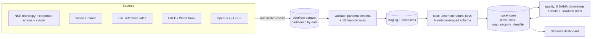

# Case study: measuring the quality of Indian market data

## Problem

A team that consumes market data needs more than "the file arrived". It needs to know whether
every expected security × session is present, whether prices agree with an independent
source, whether identifiers are consistent over time, and which unusual records deserve a
human's attention. The aim of this project was to build that as a small, honest data
product for 20 NIFTY-50 stocks over H1 2024. Every price, corporate action, FX fixing and
macro observation in it is real, downloaded from public sources.

## Architecture

Each dataset has a YAML contract (`config/datasets/`). It is the single place that defines
columns, checks, rule parameters and quality thresholds, and the pandera schema and the data
dictionary are generated from it.

## One real anomaly: 4 June 2024

On 2024-06-04 the pipeline raised:

- `unexplained_jump` (high): NTPC closed -15.5% (391.80 to 331.25) with no corporate action within ±2 days;
- `fx_rate_outlier` (medium): USD/INR moved +0.52%, a z-score of 4.9 against its 20-day history;
- all 5 IsolationForest flags, and several return/volume z-score flags (SBIN -14%, LT -13%, on 3-8x normal volume).

**What caused it** (public market context, which the pipeline does not verify): 4 June 2024
was the day India's general-election results were counted. The ruling party fell short of a
single-party majority, and the market sold off sharply before recovering over the following
days. The pipeline cannot know about elections. What it
can do is show that the move appears in both NSE and Yahoo (they agree to within 0.5pp on
every daily return), that no corporate action explains it, and that it hit many unrelated
stocks and the currency on the same day. That combination tells an analyst it is a *market
event* rather than a *data error*, which is exactly the triage a quality team performs.

## A real anomaly in the full live universe: stocks that "vanish" into the BE series

The committed sample covers 20 large caps. Running `findata validate nse_prices --mode raw`
over every EQ-series stock in the live H1-2024 bhavcopies (226,890 rows, about 2,600 symbols)
raised **8,048 `missing_trading_days` flags across 158 symbols**. For example, 3PLAND has an EQ row
on 2024-01-30 and none from 2024-01-31 onward.

**Root cause**, checked against the cached bhavcopy files: on 2024-01-31 3PLAND appears under
series **BE** (trade-for-trade, a surveillance segment where every trade must be settled by
delivery) with the same symbol and ISIN, and it keeps trading there. Across all flags,
**7,860 of 8,048 (97.7%)** are sessions in which the stock *did* trade, but in BE rather than
EQ. Only 188 are genuinely absent (most likely suspensions; not verified).

**Diagnosis:** this is a defect in our own ingestion contract, not in NSE's data.
`nse_prices` keeps only series EQ, so a stock moved into surveillance looks as though it
stopped trading. The planned fix is to keep EQ **and** BE (plus BZ for the suspended segment),
record `series` as an attribute with its own validity window, and keep `(isin, trade_date)` as
the natural key, since a stock trades in only one of these series on a given day. The
20-stock sample is unaffected because NIFTY-50 constituents stay in EQ. Other
full-universe flags were triaged too. Most of the 48 `stale_price` flags are liquid ETFs
(e.g. ABSLLIQUID, whose price is pinned at 1,000 by design) and illiquid penny stocks, so the
rule needs an instrument-type exemption. The 950 `unexplained_jump` flags outside the universe
cannot be judged, because corporate actions were only fetched for the 20 stocks.

## Two data problems the pipeline caught in its own assumptions

1. **Yahoo rewrites history.** The first cross-source accuracy check flagged 600 of 2,460
   rows. The cause was not bad NSE data. Yahoo had restated H1-2024 prices for corporate
   actions that happened *later* (bonuses, splits, the 2025 ITC Hotels demerger): its close
   was 0.5x NSE for three stocks and 0.2x for KOTAKBANK. The fix was to compare daily
   *returns* over common dates, which are unaffected by rescaling, and to report the level
   ratio as an informational basis note. False positives went from 600 to 0.
2. **Identifiers change.** NESTLEIND's 1:10 face-value split on 2024-01-05 changed its ISIN.
   Keying the price fact on ISIN would have split one security in two. Instead
   `dim_security` is keyed on the exchange listing, and ISINs live in
   `map_security_identifier` with `valid_from`/`valid_to` (SCD type 2). The validation rule
   reports the change as information, not as a conflict.

## Results

- **Six quality dimensions** are measured per dataset per run. On the samples: 31 pass,
  1 warn (Yahoo completeness 97.6%, because it lacks NSE's three Saturday special sessions),
  0 fail.
- **Precision of 50 flags:** 0.76 "worth a look" overall (ML 5/5, statistical 32/37). No
  flag found a wrong price, because the official exchange data was clean in this window. These
  labels were applied by the AI agent using written criteria and still need human re-labelling.
- **Test suite:** offline, with network calls mocked. Coverage is 96% on `src/`.

## What I would do next

- Fetch corporate actions up to today, so that the Yahoo basis differences are *explained*,
  not just measured.
- Make the sector classification point-in-time (SCD2), and add a BSE bhavcopy as a third source.
- Schedule daily incremental runs (Prefect, or GitHub Actions cron), so that timeliness
  measures real publication latency rather than a backfill.
- Have a human label a larger flag set to estimate recall, and inject synthetic defects into
  real data to measure detection rate.
