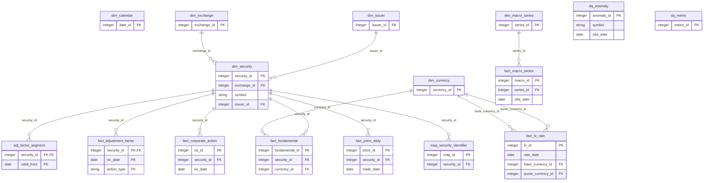

# Data dictionary

_Generated by `scripts/gen_data_dictionary.py` from `src/findata/model/tables.py` and `config/datasets/*.yaml`. Do not edit by hand._

## Schema diagram

## Warehouse tables

### `dim_calendar`

Calendar days with NSE trading-session flag.

**Primary key:** `date_id`  
**Natural key / unique:** `(cal_date)`  

| Column | Type | Null | Description |
|---|---|---|---|
| `date_id` | INTEGER | no | Surrogate key, yyyymmdd |
| `cal_date` | DATE | no | Calendar date |
| `year` | INTEGER | no |  |
| `quarter` | INTEGER | no |  |
| `month` | INTEGER | no |  |
| `day_of_week` | INTEGER | no | 0 = Monday |
| `is_weekend` | BOOLEAN | no |  |
| `is_nse_trading_day` | BOOLEAN | no | NSE cash market session held |
| `holiday_name` | VARCHAR(128) | yes | Reason when a weekday is closed |

### `dim_currency`

Currencies (ISO 4217).

**Primary key:** `currency_id`  
**Natural key / unique:** `(code)`  

| Column | Type | Null | Description |
|---|---|---|---|
| `currency_id` | INTEGER | no | Surrogate key |
| `code` | VARCHAR(3) | no | ISO 4217 code |
| `name` | VARCHAR(64) | no | Currency name |

### `dim_exchange`

Exchanges / trading venues.

**Primary key:** `exchange_id`  
**Natural key / unique:** `(mic)`  

| Column | Type | Null | Description |
|---|---|---|---|
| `exchange_id` | INTEGER | no | Surrogate key |
| `mic` | VARCHAR(8) | no | ISO 10383 market identifier code |
| `name` | VARCHAR(128) | no | Exchange name |
| `country` | VARCHAR(2) | no | ISO 3166 alpha-2 country |
| `timezone` | VARCHAR(64) | no | IANA timezone of the trading session |
| `currency_code` | VARCHAR(3) | no | Trading currency |

### `dim_issuer`

Legal entities that issue securities (GLEIF).

**Primary key:** `issuer_id`  
**Natural key / unique:** `(lei)`  

| Column | Type | Null | Description |
|---|---|---|---|
| `issuer_id` | INTEGER | no | Surrogate key |
| `lei` | VARCHAR(20) | yes | ISO 17442 Legal Entity Identifier |
| `legal_name` | VARCHAR(256) | no | Registered legal name (GLEIF) |
| `country` | VARCHAR(2) | yes | Legal address country |
| `entity_status` | VARCHAR(16) | yes | GLEIF entity status |
| `parent_lei` | VARCHAR(20) | yes | Direct parent LEI, if reported |
| `load_ts` | DATETIME | no |  |

### `dim_macro_series`

Macro-economic time series catalogue.

**Primary key:** `series_id`  
**Natural key / unique:** `(source, code)`  

| Column | Type | Null | Description |
|---|---|---|---|
| `series_id` | INTEGER | no | Surrogate key |
| `source` | VARCHAR(16) | no | fred / worldbank |
| `code` | VARCHAR(64) | no | Series code at the source |
| `name` | VARCHAR(256) | yes |  |
| `frequency` | VARCHAR(16) | yes | D / M / A |
| `units` | VARCHAR(64) | yes |  |

### `dq_anomaly`

Every flagged record; status survives reloads (upsert does not touch it).

**Primary key:** `anomaly_id`  
**Natural key / unique:** `(dataset, record_key, rule)`  

| Column | Type | Null | Description |
|---|---|---|---|
| `anomaly_id` | INTEGER | no |  |
| `dataset` | VARCHAR(64) | no |  |
| `record_key` | VARCHAR(128) | no |  |
| `rule` | VARCHAR(64) | no |  |
| `severity` | VARCHAR(8) | no |  |
| `detail` | TEXT | no |  |
| `detected_by` | VARCHAR(16) | no | rule / statistical / ml |
| `symbol` | VARCHAR(64) | yes |  |
| `obs_date` | DATE | yes |  |
| `value` | FLOAT | yes |  |
| `status` | VARCHAR(16) | no | open / reviewed / false_positive |
| `first_seen_ts` | DATETIME | no |  |
| `last_seen_ts` | DATETIME | no |  |
| `reviewed_ts` | DATETIME | yes |  |

### `dq_metric`

Quality metric values per dataset per run.

**Primary key:** `metric_id`  
**Natural key / unique:** `(run_id, dataset, metric)`  

| Column | Type | Null | Description |
|---|---|---|---|
| `metric_id` | INTEGER | no |  |
| `run_id` | VARCHAR(32) | no | Quality run identifier |
| `run_ts` | DATETIME | no |  |
| `dataset` | VARCHAR(64) | no |  |
| `dimension` | VARCHAR(16) | no | completeness/timeliness/accuracy/... |
| `metric` | VARCHAR(64) | no |  |
| `value` | FLOAT | yes |  |
| `threshold` | FLOAT | yes |  |
| `status` | VARCHAR(8) | no | pass / warn / fail / n/a |

### `dim_security`

One row per exchange listing; identifiers live in map_security_identifier.

**Primary key:** `security_id`  
**Natural key / unique:** `(exchange_id, symbol)`  
**Foreign keys:** `issuer_id` → `dim_issuer`; `exchange_id` → `dim_exchange`  

| Column | Type | Null | Description |
|---|---|---|---|
| `security_id` | INTEGER | no | Surrogate key |
| `exchange_id` | INTEGER | no |  |
| `symbol` | VARCHAR(32) | no | Exchange ticker |
| `name` | VARCHAR(256) | yes | Security / company name |
| `sector` | VARCHAR(64) | yes | NIFTY industry classification |
| `security_type` | VARCHAR(32) | yes | e.g. Common Stock (OpenFIGI) |
| `issuer_id` | INTEGER | yes |  |
| `face_value` | FLOAT | yes | Current face value, INR |
| `listing_date` | DATE | yes |  |
| `load_ts` | DATETIME | no |  |

### `fact_fx_rate`

Reference FX fixings.

**Primary key:** `fx_id`  
**Natural key / unique:** `(rate_date, base_currency_id, quote_currency_id, source)`  
**Foreign keys:** `quote_currency_id` → `dim_currency`; `base_currency_id` → `dim_currency`  

| Column | Type | Null | Description |
|---|---|---|---|
| `fx_id` | INTEGER | no |  |
| `rate_date` | DATE | no |  |
| `base_currency_id` | INTEGER | no |  |
| `quote_currency_id` | INTEGER | no |  |
| `units` | FLOAT | no | Units of base currency quoted |
| `rate` | FLOAT | no | Quote currency per `units` base |
| `source` | VARCHAR(16) | no |  |
| `source_ts` | DATETIME | yes |  |
| `load_ts` | DATETIME | no |  |

### `fact_macro_series`

Macro observations; revisions are new vintages, never overwrites.

**Primary key:** `macro_id`  
**Natural key / unique:** `(series_id, obs_date, vintage_date)`  
**Foreign keys:** `series_id` → `dim_macro_series`  

| Column | Type | Null | Description |
|---|---|---|---|
| `macro_id` | INTEGER | no |  |
| `series_id` | INTEGER | no |  |
| `obs_date` | DATE | no |  |
| `vintage_date` | DATE | no | Date the value was observed |
| `value` | FLOAT | yes |  |
| `source_ts` | DATETIME | yes |  |
| `load_ts` | DATETIME | no |  |

### `adj_factor_segment`

Piecewise-constant cumulative factor; backs the v_price_adjusted view.

**Primary key:** `security_id, valid_from`  
**Foreign keys:** `security_id` → `dim_security`  

| Column | Type | Null | Description |
|---|---|---|---|
| `security_id` | INTEGER | no |  |
| `valid_from` | DATE | no |  |
| `valid_to` | DATE | no |  |
| `cumulative_factor` | FLOAT | no | Product of factors of later events |

### `fact_adjustment_factor`

Per-event price adjustment factors derived from corporate actions.

**Primary key:** `security_id, ex_date, action_type`  
**Foreign keys:** `security_id` → `dim_security`  

| Column | Type | Null | Description |
|---|---|---|---|
| `security_id` | INTEGER | no |  |
| `ex_date` | DATE | no |  |
| `action_type` | VARCHAR(16) | no |  |
| `factor` | FLOAT | no | Multiply pre-ex-date prices by this |
| `load_ts` | DATETIME | no |  |

### `fact_corporate_action`

Corporate actions with ex/record dates.

**Primary key:** `ca_id`  
**Natural key / unique:** `(security_id, ex_date, subject)`  
**Foreign keys:** `security_id` → `dim_security`  

| Column | Type | Null | Description |
|---|---|---|---|
| `ca_id` | INTEGER | no |  |
| `security_id` | INTEGER | no |  |
| `ex_date` | DATE | no |  |
| `record_date` | DATE | yes |  |
| `action_type` | VARCHAR(16) | no | dividend/split/bonus/rights/buyback/other |
| `subject` | TEXT | no | Source free text |
| `ratio` | FLOAT | yes | Post/pre price ratio for split & bonus |
| `amount` | FLOAT | yes | Cash per share, INR |
| `source_ts` | DATETIME | yes |  |
| `load_ts` | DATETIME | no |  |

### `fact_fundamental`

Quarterly fundamentals (not populated yet; see known issues).

**Primary key:** `fundamental_id`  
**Natural key / unique:** `(security_id, period_end, metric, source)`  
**Foreign keys:** `currency_id` → `dim_currency`; `security_id` → `dim_security`  

| Column | Type | Null | Description |
|---|---|---|---|
| `fundamental_id` | INTEGER | no |  |
| `security_id` | INTEGER | no |  |
| `period_end` | DATE | no |  |
| `metric` | VARCHAR(64) | no |  |
| `value` | FLOAT | yes |  |
| `currency_id` | INTEGER | yes |  |
| `source` | VARCHAR(16) | no |  |
| `source_ts` | DATETIME | yes |  |
| `load_ts` | DATETIME | no |  |

### `fact_price_daily`

Daily OHLCV per listing and source, stored unadjusted.

**Primary key:** `price_id`  
**Natural key / unique:** `(security_id, trade_date, source)`  
**Foreign keys:** `security_id` → `dim_security`  

| Column | Type | Null | Description |
|---|---|---|---|
| `price_id` | INTEGER | no |  |
| `security_id` | INTEGER | no |  |
| `trade_date` | DATE | no |  |
| `source` | VARCHAR(16) | no | nse (primary) / yahoo (cross-check) |
| `isin_observed` | VARCHAR(12) | yes | ISIN printed on the source row |
| `open` | FLOAT | yes |  |
| `high` | FLOAT | yes |  |
| `low` | FLOAT | yes |  |
| `close` | FLOAT | yes | Unadjusted close (Yahoo: split-adjusted) |
| `prev_close` | FLOAT | yes |  |
| `volume` | FLOAT | yes |  |
| `turnover` | FLOAT | yes |  |
| `trades` | FLOAT | yes |  |
| `source_ts` | DATETIME | yes | When the source published the record |
| `load_ts` | DATETIME | no | When we loaded it |

### `map_security_identifier`

Identifier history (SCD2): e.g. ISIN changes after a face-value split.

**Primary key:** `map_id`  
**Natural key / unique:** `(security_id, id_type, id_value, valid_from)`  
**Foreign keys:** `security_id` → `dim_security`  

| Column | Type | Null | Description |
|---|---|---|---|
| `map_id` | INTEGER | no |  |
| `security_id` | INTEGER | no |  |
| `id_type` | VARCHAR(16) | no | ISIN / TICKER / FIGI / COMPOSITE_FIGI / LEI |
| `id_value` | VARCHAR(64) | no |  |
| `source` | VARCHAR(16) | no | Where the mapping was observed |
| `valid_from` | DATE | no | First date the mapping is valid |
| `valid_to` | DATE | yes | Last date valid; NULL = still current |
| `load_ts` | DATETIME | no |  |

## Views

### `v_price_adjusted`

NSE prices with split/dividend-adjusted OHLC: `adjusted_x = x * cumulative_factor`, where the factor comes from the `adj_factor_segment` covering the trade date (1.0 when none).

## Dataset contracts (staging)

Every dataset is validated against its YAML contract before it reaches staging.

### `fred_macro`

US macro series from FRED (St. Louis Fed): CPI, effective Fed funds, 10y Treasury yield, VIX, USD/INR (H.10).

- **Source:** fred — `https://fred.stlouisfed.org/graph/fredgraph.csv?id={series}`
- **Schedule:** Daily or monthly depending on the series
- **Grain:** one row per (series_id, obs_date)
- **Natural key:** `series_id, obs_date`
- **Quality thresholds:** completeness_min=0.95, validity_min=1.0, uniqueness_min=1.0
- **Rules:** `duplicate_keys`, `macro_revision_detected`

| Column | Type | Null | Checks | Description |
|---|---|---|---|---|
| `series_id` | str | no |  | FRED series code |
| `obs_date` | date | no |  | Observation date (period start for monthly series) |
| `value` | float | yes |  | Observed value; null when FRED reports '.' (no observation, e.g. US holiday) |
| `vintage_date` | date | no |  | Date we observed this value (revision tracking) |
| `ingest_ts` | datetime | no |  | Download time (UTC) |

### `fx_rates`

FBIL reference rates for INR against USD, GBP, EUR and JPY (JPY quoted per 100). FBIL took over administration of the RBI reference rate in July 2018, so this is the official INR fixing. 

- **Source:** fbil — `https://www.fbil.org.in/wasdm/refrates/fetchfiltered`
- **Schedule:** Business days, ~13:30 IST
- **Grain:** one row per (rate_date, base_ccy)
- **Natural key:** `rate_date, base_ccy, quote_ccy`
- **Quality thresholds:** completeness_min=0.98, timeliness_max_hours=6.0, validity_min=1.0, uniqueness_min=1.0
- **Rules:** `duplicate_keys`, `fx_rate_outlier`

| Column | Type | Null | Checks | Description |
|---|---|---|---|---|
| `rate_date` | date | no |  | Fixing date |
| `base_ccy` | str | no | in {USD, GBP, EUR, JPY} | Foreign currency |
| `quote_ccy` | str | no | in {INR} | Always INR |
| `units` | float | no | > 0 | Units of base currency quoted (100 for JPY) |
| `rate` | float | no | > 0 | INR per `units` of base currency |
| `source_ts` | datetime | yes |  | Publication time reported by FBIL (UTC) |
| `ingest_ts` | datetime | no |  | Download time (UTC) |

### `gleif_lei`

GLEIF Legal Entity Identifier records for the issuers in the universe, including the direct parent LEI. Lookup tries filter[isin] first; GLEIF returned nothing for Indian ISINs, so it falls back to an exact match on the normalised legal name (entity resolution). 

- **Source:** gleif — `https://api.gleif.org/api/v1/lei-records (filter[isin], then filter[entity.legalName])`
- **Schedule:** Weekly
- **Grain:** one row per ISIN
- **Natural key:** `isin`
- **Quality thresholds:** completeness_min=0.9, validity_min=1.0, uniqueness_min=1.0
- **Rules:** `duplicate_keys`

| Column | Type | Null | Checks | Description |
|---|---|---|---|---|
| `isin` | str | no | matches `^IN[A-Z0-9]{9}[0-9]$` | Queried ISIN |
| `lei` | str | no | matches `^[A-Z0-9]{18}[0-9]{2}$` | 20-character ISO 17442 LEI |
| `legal_name` | str | no |  | Registered legal name |
| `country` | str | yes |  | Legal address country |
| `entity_status` | str | yes |  | ACTIVE / INACTIVE |
| `registration_status` | str | yes |  | ISSUED / LAPSED / ... |
| `parent_lei` | str | yes |  | Direct accounting-consolidation parent LEI |
| `ingest_ts` | datetime | no |  | Download time (UTC) |

### `nse_corporate_actions`

Corporate actions announced on NSE (dividends, splits, bonuses, rights, buybacks) with ex and record dates. They explain price jumps and drive the adjustment-factor table. 

- **Source:** nse — `https://www.nseindia.com/api/corporates-corporateActions?index=equities`
- **Schedule:** Daily; actions are announced weeks before the ex-date
- **Grain:** one row per (symbol, ex_date, subject)
- **Natural key:** `symbol, ex_date, subject`
- **Quality thresholds:** completeness_min=0.95, validity_min=0.99, uniqueness_min=1.0
- **Rules:** `duplicate_keys`

| Column | Type | Null | Checks | Description |
|---|---|---|---|---|
| `symbol` | str | no |  | NSE ticker |
| `series` | str | yes |  | Series the action applies to |
| `isin` | str | yes |  | ISIN at announcement |
| `company` | str | yes |  | Company name |
| `subject` | str | no |  | Free text from NSE, e.g. 'Dividend - Rs 10 Per Share' |
| `ex_date` | date | no |  | First session the stock trades without the entitlement |
| `record_date` | date | yes |  | Date the register of members is frozen |
| `face_value` | float | yes |  | Face value at announcement, INR |
| `action_type` | str | no | in {dividend, split, bonus, rights, buyback, other} | Category parsed from subject |
| `ratio` | float | yes | > 0 | Price adjustment ratio for split/bonus (post price / pre price) |
| `amount` | float | yes | >= 0 | Cash per share for dividends, INR |
| `ingest_ts` | datetime | no |  | Download time (UTC) |

### `nse_prices`

NSE capital-market bhavcopy (UDiFF format): official end-of-day OHLCV for every security traded on the NSE cash segment. This is the primary price source. 

- **Source:** nse — `https://nsearchives.nseindia.com/content/cm/BhavCopy_NSE_CM_0_0_0_{YYYYMMDD}_F_0000.csv.zip`
- **Schedule:** Business days, after ~18:00 IST
- **Grain:** one row per (isin, trade_date) for series EQ
- **Natural key:** `isin, trade_date`
- **Quality thresholds:** completeness_min=0.99, timeliness_max_hours=6.0, validity_min=0.999, uniqueness_min=1.0, accuracy_tolerance_pct=0.5, accuracy_min=0.98, consistency_min=0.999
- **Rules:** `ohlc_sanity`, `duplicate_keys`, `missing_trading_days`, `stale_price`, `unexplained_jump`, `split_adjustment_check`, `cross_source_price_diff`, `identifier_conflict`

| Column | Type | Null | Checks | Description |
|---|---|---|---|---|
| `trade_date` | date | no |  | Trading session date (IST) |
| `symbol` | str | no |  | NSE ticker (TckrSymb) |
| `series` | str | no |  | Trading series; EQ = rolling-settlement equity |
| `isin` | str | no | matches `^IN[A-Z0-9]{9}[0-9]$` | ISIN of the instrument |
| `name` | str | yes |  | Instrument name as published |
| `open` | float | no | > 0 | Opening price, INR |
| `high` | float | no | > 0 | Session high, INR |
| `low` | float | no | > 0 | Session low, INR |
| `close` | float | no | > 0 | Official closing price, INR |
| `prev_close` | float | yes |  | Previous close as published by NSE |
| `volume` | float | no | >= 0 | Shares traded |
| `turnover` | float | yes | >= 0 | Traded value, INR |
| `trades` | float | yes | >= 0 | Number of trades |
| `source_ts` | datetime | yes |  | HTTP Last-Modified of the file (UTC): when NSE published it |
| `ingest_ts` | datetime | no |  | When we downloaded it (UTC) |

### `nse_securities`

NSE equity master (EQUITY_L.csv): current symbol, ISIN, listing date and face value of every listed equity.

- **Source:** nse — `https://nsearchives.nseindia.com/content/equities/EQUITY_L.csv`
- **Schedule:** Snapshot; refreshed on every ingest
- **Grain:** one row per symbol
- **Natural key:** `symbol`
- **Quality thresholds:** completeness_min=1.0, validity_min=1.0, uniqueness_min=1.0
- **Rules:** `duplicate_keys`

| Column | Type | Null | Checks | Description |
|---|---|---|---|---|
| `symbol` | str | no |  | NSE ticker |
| `company` | str | no |  | Company name |
| `series` | str | yes |  | Series |
| `listing_date` | date | yes |  | Date of listing on NSE |
| `isin` | str | no | matches `^IN[A-Z0-9]{9}[0-9]$` | Current ISIN |
| `face_value` | float | yes | > 0 | Current face value, INR |
| `snapshot_date` | date | no |  | Date the master was downloaded |

### `openfigi_mapping`

OpenFIGI mapping of ISIN to FIGI. FIGI (Financial Instrument Global Identifier) is an open OMG standard originated by Bloomberg, and it is free to use and redistribute. 

- **Source:** openfigi — `https://api.openfigi.com/v3/mapping`
- **Schedule:** On demand when new ISINs appear
- **Grain:** one row per ISIN (the NSE listing, exchCode IN)
- **Natural key:** `isin`
- **Quality thresholds:** completeness_min=0.95, validity_min=1.0, uniqueness_min=1.0, consistency_min=0.95
- **Rules:** `duplicate_keys`

| Column | Type | Null | Checks | Description |
|---|---|---|---|---|
| `isin` | str | no | matches `^IN[A-Z0-9]{9}[0-9]$` | Queried ISIN |
| `figi` | str | no | matches `^BBG[A-Z0-9]{9}$` | FIGI of the Indian listing |
| `composite_figi` | str | yes |  | Composite (country-level) FIGI |
| `share_class_figi` | str | yes |  | Share-class FIGI (global) |
| `ticker` | str | yes |  | Ticker reported by OpenFIGI |
| `name` | str | yes |  | Instrument name |
| `security_type` | str | yes |  | e.g. Common Stock |
| `exch_code` | str | yes |  | Bloomberg exchange code |
| `ingest_ts` | datetime | no |  | Download time (UTC) |

### `worldbank_macro`

World Bank WDI annual indicators for India: GDP (current US$), CPI inflation, population.

- **Source:** worldbank — `https://api.worldbank.org/v2/country/IND/indicator/{indicator}?format=json`
- **Schedule:** Annual, revised several times a year
- **Grain:** one row per (series_id, obs_date)
- **Natural key:** `series_id, obs_date`
- **Quality thresholds:** completeness_min=0.8, validity_min=1.0, uniqueness_min=1.0
- **Rules:** `duplicate_keys`, `macro_revision_detected`

| Column | Type | Null | Checks | Description |
|---|---|---|---|---|
| `series_id` | str | no |  | WDI indicator code |
| `obs_date` | date | no |  | Jan 1 of the observation year |
| `value` | float | yes |  | Indicator value |
| `vintage_date` | date | no |  | Date we observed this value |
| `ingest_ts` | datetime | no |  | Download time (UTC) |

### `yahoo_prices`

Yahoo Finance daily OHLCV for the same NSE tickers (".NS" suffix), fetched with the unofficial yfinance library. It is used only as a second source for accuracy cross-checks. Yahoo's Close is split-adjusted but not dividend-adjusted. 

- **Source:** yahoo — `https://finance.yahoo.com (via yfinance)`
- **Schedule:** Daily
- **Grain:** one row per (symbol, trade_date)
- **Natural key:** `symbol, trade_date`
- **Quality thresholds:** completeness_min=0.98, validity_min=0.99, uniqueness_min=1.0
- **Rules:** `ohlc_sanity`, `duplicate_keys`

| Column | Type | Null | Checks | Description |
|---|---|---|---|---|
| `trade_date` | date | no |  | Session date |
| `symbol` | str | no |  | NSE ticker without the .NS suffix |
| `open` | float | yes | > 0 | Open (split-adjusted) |
| `high` | float | yes | > 0 | High (split-adjusted) |
| `low` | float | yes | > 0 | Low (split-adjusted) |
| `close` | float | yes | > 0 | Close (split-adjusted) |
| `adj_close` | float | yes | > 0 | Close adjusted for splits and dividends |
| `volume` | float | yes | >= 0 | Volume (split-adjusted) |
| `ingest_ts` | datetime | no |  | Download time (UTC) |
