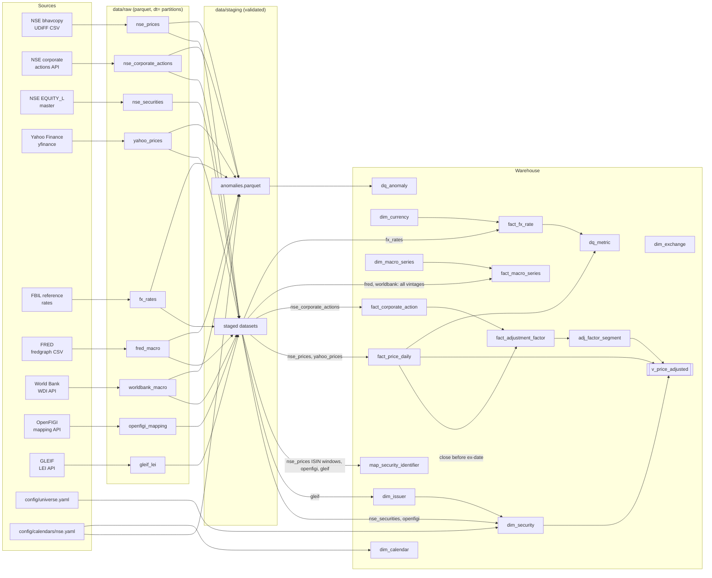

# Lineage

How each warehouse table is derived, from public source to `dq_*` tables. Every arrow is code in
`src/findata`: `ingest/` (source → raw), `validate/` (raw → staging + anomalies),
`model/loaders.py` (staging → warehouse) and `quality/` (warehouse → dq tables).

## Notes

- **Raw is append-by-partition.** Re-ingesting a date replaces its `dt=` partition, so raw is
  idempotent. Macro datasets are partitioned by *vintage* date, which keeps every revision.
- **Warehouse scope = universe.** `dim_security` and the price/action facts hold the 20 symbols
  in `config/universe.yaml`. Raw and staging keep the full NSE file.
- **Adjusted prices are derived, never stored as the only copy.** Raw closes are kept in
  `fact_price_daily`, and `v_price_adjusted` multiplies them by the factor segment (ADR 0003).
- **Analytics** (`src/findata/analytics/queries.py`) read `v_price_adjusted`,
  `fact_corporate_action`, `fact_fx_rate` and `fact_macro_series` (latest vintage).
